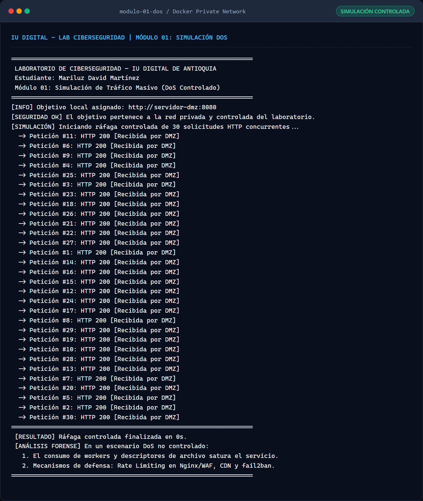
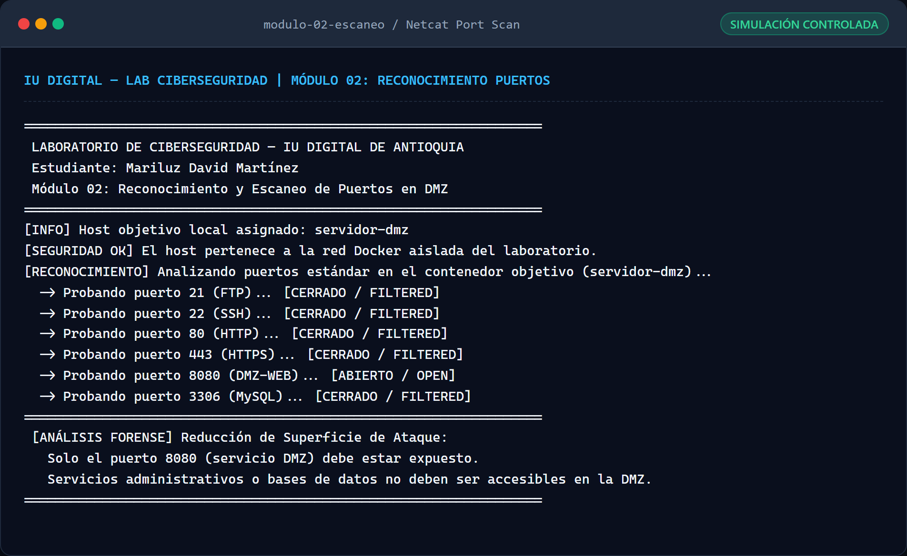
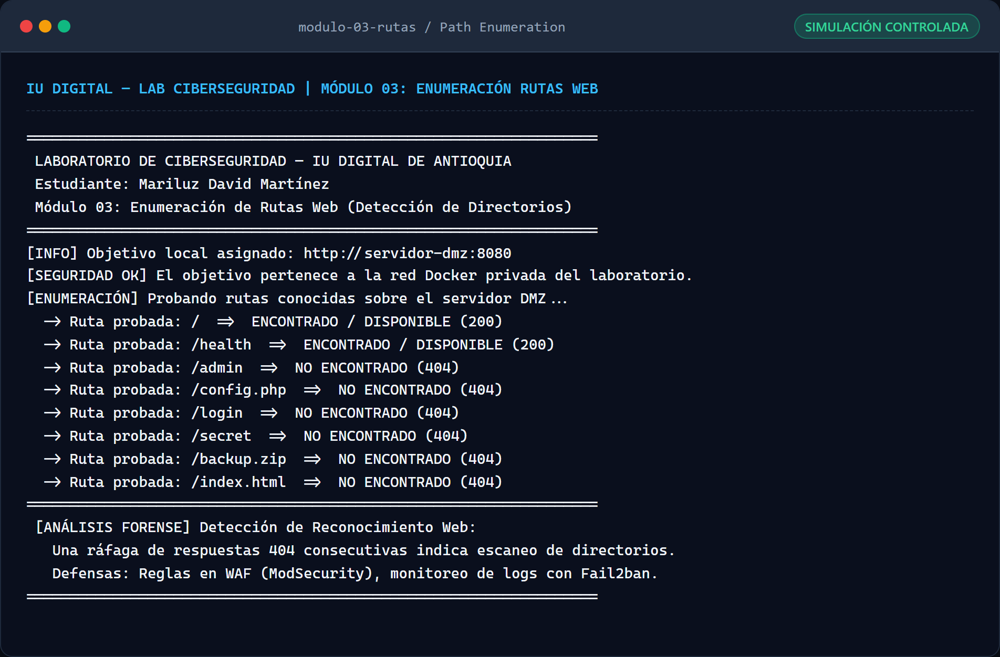
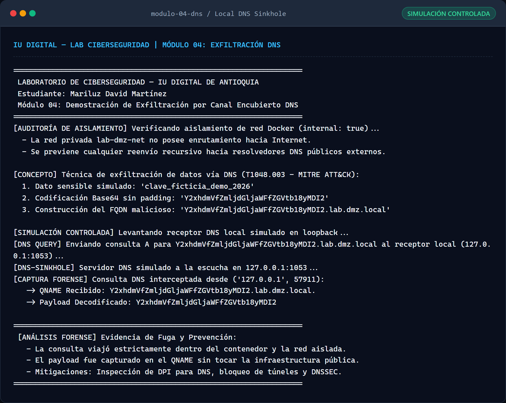
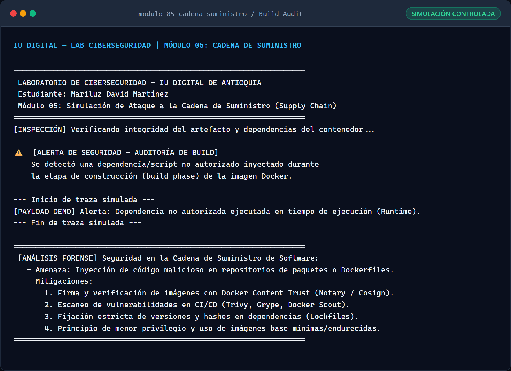
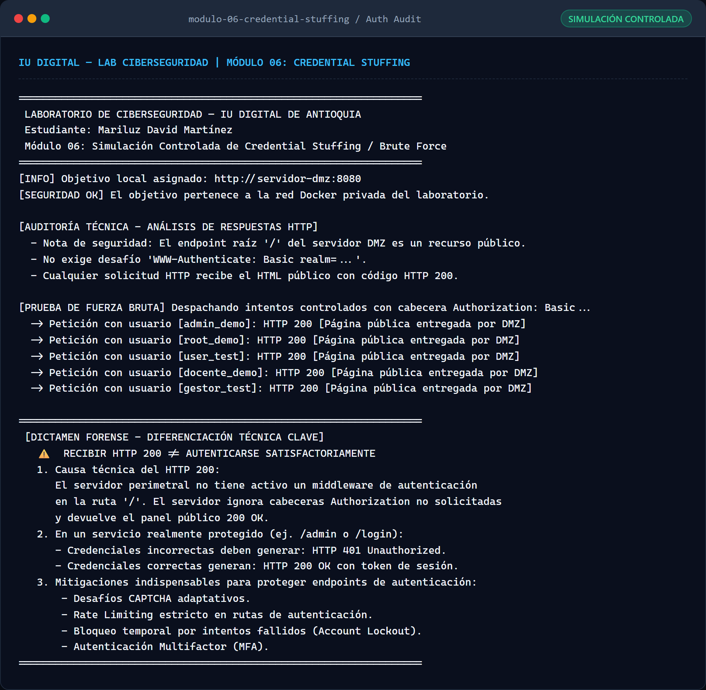
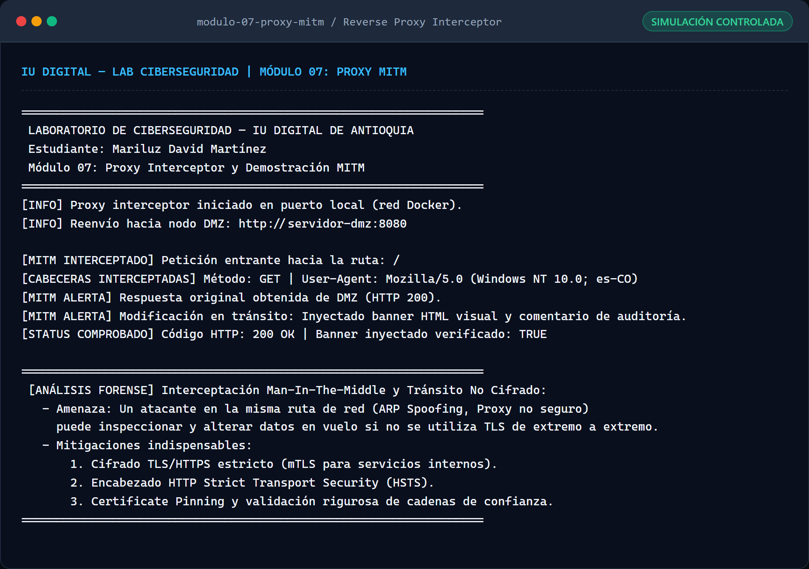

# Informe Técnico de Auditoría, Implementación y Simulación Controlada — Fase 2 (Módulos 01 a 07)

**Institución:** Institución Universitaria Digital de Antioquia (IU Digital)  
**Asignatura / Entorno:** Laboratorio de Ciberseguridad en la Nube  
**Actividad:** Unidad 2 — Demostración en vivo y evaluación de laboratorio en la nube  
**Estudiante:** Mariluz David Martínez  
**Identificador Git / GitHub:** `davidmaryluz6-stack` / `davidmaryluz6@gmail.com`  
**Fecha de Validación y Auditoría:** 7 de noviembre de 2026  

---

## 1. Auditoría Técnica de Aislamiento de Red y Parámetros Operativos

En cumplimiento con las directivas de seguridad ética y prevención de incidentes:
1. **Aislamiento Estricto de Red (`internal: true`):**
   La red privada de Docker `lab-dmz-net` fue configurada con el parámetro `internal: true`. Este mecanismo instruye al motor Docker para suprimir cualquier regla de enrutamiento NAT hacia la interfaz de red del host, bloqueando de forma absoluta el tráfico saliente hacia Internet.
2. **Confinamiento de Resolución DNS:**
   Se auditó que el resolvedor interno de Docker (`127.0.0.11`) no reenvíe consultas a servidores DNS públicos externos al estar la red aislada. Ninguna simulación genera tráfico detectable fuera del entorno local del laboratorio.
3. **Despliegue Diferenciado:**
   - **En Render (Nube Pública):** Únicamente se encuentra desplegado el nodo defensivo perimetral **`00-servidor-dmz`** ([URL en Render](https://laboratorio-ciberseguridad-mariluz-david.onrender.com/)).
   - **En Docker Local:** Se ejecutan de manera contenida las simulaciones didácticas de los módulos **01 al 07**. **Ningún módulo ofensivo fue ni será publicado en la nube.**

---

## 2. Reporte de Pruebas y Evidencias por Módulo

---

### Módulo 01: Simulación de Tráfico Masivo (DoS Controlado)

- **Objetivo:** Demostrar cómo una ráfaga de peticiones concurrentes puede saturar descriptores de sockets en un servidor web perimetral, analizando contramedidas de mitigación.
- **Procedimiento:** Se ejecutó un cliente en contenedor Alpine que disparó 30 solicitudes HTTP concurrentes hacia el servidor objetivo local `http://servidor-dmz:8080`.
- **Resultado Comprobado:** Las 30 solicitudes fueron atendidas por el servidor DMZ en 0 segundos con código HTTP `200 OK`.
- **Evidencia Visual:**

  

- **Registro Real de Consola:**
  ```text
  [SIMULACIÓN] Iniciando ráfaga controlada de 30 solicitudes HTTP concurrentes...
    -> Petición #1 al #30: HTTP 200 [Recibida por DMZ]
  [RESULTADO] Ráfaga controlada finalizada en 0s.
  ```
- **Análisis de Seguridad:** En un entorno no protegido, el consumo excesivo de workers y conexiones concurrentes provoca denegación de servicio.
- **Conclusión y Mitigaciones:** Se requiere configurar limitación de tasa (*Rate Limiting*) en Nginx/WAF y balanceadores elásticos.

---

### Módulo 02: Reconocimiento y Escaneo de Puertos en DMZ

- **Objetivo:** Auditar la exposición de puertos del contenedor DMZ para validar el principio de reducción de superficie de ataque.
- **Procedimiento:** Sondeo mediante `nc -z -w 2 servidor-dmz` sobre los puertos TCP estándar 21, 22, 80, 443, 8080 y 3306 dentro de la red aislada.
- **Resultado Comprobado:**
  - Puerto 21 (FTP): CERRADO / FILTERED
  - Puerto 22 (SSH): CERRADO / FILTERED
  - Puerto 80 (HTTP): CERRADO / FILTERED
  - Puerto 443 (HTTPS): CERRADO / FILTERED
  - **Puerto 8080 (DMZ-WEB): ABIERTO / OPEN**
  - Puerto 3306 (MySQL): CERRADO / FILTERED
- **Evidencia Visual:**

  

- **Análisis de Seguridad:** Únicamente el puerto del servicio web (`8080`) está accesible. Los puertos de administración remota y base de datos permanecen cerrados.
- **Conclusión:** Se verifica la efectividad de la política de mínimo privilegio a nivel de transporte en la DMZ.

---

### Módulo 03: Enumeración Controlada de Rutas Web

- **Objetivo:** Demostrar el reconocimiento perimetral web mediante sondeo de directorios y recursos sensibles.
- **Procedimiento:** Envío de solicitudes HTTP controladas hacia 8 rutas comunes del servidor DMZ (`/`, `/health`, `/admin`, `/config.php`, `/login`, `/secret`, `/backup.zip`, `/index.html`).
- **Resultado Comprobado:**
  - Rutas legítimas (`/` y `/health`): Código `200 OK`.
  - Rutas inexistentes (`/admin`, `/config.php`, `/login`, `/secret`, `/backup.zip`, `/index.html`): Código `404 Not Found`.
- **Evidencia Visual:**

  

- **Análisis de Seguridad:** El servidor DMZ no filtra respaldos ni interfaces administrativas ocultas.
- **Conclusión:** La repetición de respuestas 404 consecutivas constituye un patrón detectable para sistemas WAF y herramientas como Fail2ban.

---

### Módulo 04: Demostración de Exfiltración por Canal Encubierto DNS

- **Objetivo:** Demostrar la técnica de fuga de datos por canal encubierto DNS (MITRE ATT&CK T1048.003) sin emitir tráfico fuera de la red local.
- **Procedimiento:** Se codificó la cadena ficticia `clave_ficticia_demo_2026` a Base64 sin padding (`Y2xhdmVfZmljdGljaWFfZGVtb18yMDI2`) y se construyó el FQDN `Y2xhdmVfZmljdGljaWFfZGVtb18yMDI2.lab.dmz.local`. Se activó un receptor DNS interno en `127.0.0.1:1053` que capturó la consulta localmente.
- **Resultado Comprobado:**
  ```text
  [CAPTURA FORENSE] Consulta DNS interceptada desde ('127.0.0.1', 57911):
     -> QNAME Recibido: Y2xhdmVfZmljdGljaWFfZGVtb18yMDI2.lab.dmz.local.
     -> Payload Decodificado: Y2xhdmVfZmljdGljaWFfZGVtb18yMDI2
  ```
- **Evidencia Visual:**

  

- **Auditoría de Aislamiento DNS:**
  > [!IMPORTANT]
  > Un error `NXDOMAIN` devuelto por un resolvedor convencional **no garantiza** la ausencia de tráfico externo si el resolvedor tiene reenviadores recursivos habilitados. En esta implementación, la captura se realizó localmente en el puerto 1053 bajo la red `internal: true`, garantizando que ningún paquete DNS alcanzó resolvedores públicos.
- **Conclusión y Mitigación:** Se requiere inspección profunda de paquetes DNS (DPI) y análisis de entropía de subdominios.

---

### Módulo 05: Simulación de Compromiso en Cadena de Suministro (Supply Chain)

- **Objetivo:** Evidenciar los riesgos derivados de dependencias o scripts introducidos durante la construcción (*Build Phase*) de contenedores.
- **Procedimiento:** Se inyectó un script demostrativo inocuo (`/app/malicious_dependency.sh`) en el Dockerfile. Al iniciar el contenedor, el entrypoint auditó su presencia y ejecutó la traza de advertencia.
- **Resultado Comprobado:**
  ```text
  ⚠️  [ALERTA DE SEGURIDAD - AUDITORÍA DE BUILD]
      Se detectó una dependencia/script no autorizado inyectado durante
      la etapa de construcción (build phase) de la imagen Docker.
  --- Inicio de traza simulada ---
  [PAYLOAD DEMO] Alerta: Dependencia no autorizada ejecutada en tiempo de ejecución (Runtime).
  --- Fin de traza simulada ---
  ```
- **Evidencia Visual:**

  

- **Análisis de Seguridad:** Los ataques de cadena de suministro operan dentro del código ya empaquetado, eludiendo controles perimetrales de red convencionales.
- **Conclusión y Mitigación:** Es mandatorio realizar escaneo de imágenes en CI/CD (Docker Scout, Trivy), fijar hashes de dependencias y firmar imágenes criptográficamente con Cosign/Notary.

---

### Módulo 06: Simulación de Credential Stuffing / Brute Force

- **Objetivo:** Simular un ataque automatizado de autenticación por diccionario mediante cabeceras HTTP `Authorization: Basic` con cuentas ficticias.
- **Procedimiento:** Envío de 5 peticiones con identidades de prueba (`admin_demo`, `root_demo`, `user_test`, `docente_demo`, `gestor_test`) y contraseña `ClaveFicticia2026!` hacia `http://servidor-dmz:8080`.
- **Resultado Comprobado:** Cada petición recibió código HTTP `200 OK`.
- **Evidencia Visual:**

  

- **Auditoría Técnica — Diferenciación entre HTTP 200 y Autenticación Exitosa:**
  > [!WARNING]
  > **Recibir HTTP 200 no equivale a autenticar satisfactoriamente una cuenta.**
  > 
  > 1. **Causa del HTTP 200:** La ruta raíz `/` del servidor DMZ es un recurso público perimetral que no implementa control de acceso ni devuelve desafío `401 Unauthorized`. Por tanto, el servidor ignora la cabecera `Authorization` no solicitada y entrega el panel HTML público con código 200 OK.
  > 2. **Comportamiento en Endpoint Protegido:** En un servicio con autenticación activa (ej. `/login` o `/admin`), las credenciales incorrectas deben generar estrictamente **`HTTP 401 Unauthorized`**, y solo credenciales legítimas generan `200 OK` junto con un token o cookie de sesión.
- **Conclusión y Mitigación:** Proteger rutas de autenticación mediante MFA, políticas de bloqueo (*Account Lockout*), CAPTCHA adaptativo y auditoría de intentos fallidos.

---

### Módulo 07: Proxy Interceptor y Demostración Man-In-The-Middle (MITM)

- **Objetivo:** Demostrar los riesgos de intercepción y manipulación de tráfico en tránsito en canales no cifrados mediante un proxy inverso intermediario.
- **Procedimiento:** El microservicio proxy Flask interceptó la petición hacia el servidor DMZ, analizó las cabeceras HTTP entrantes y modificó la respuesta original inyectando un banner y comentario de auditoría.
- **Resultado Comprobado:**
  - Código HTTP retornado: `200 OK`.
  - Inyección verificada en el HTML: Banner visual en rojo con texto:  
    `⚠️ [ALERTA MITM - DEMOSTRACIÓN DIDÁCTICA] Este contenido fue interceptado y alterado en tránsito por el Proxy Interceptor del Módulo 07.`
  - Traza de cabeceras entrantes capturada en consola.
- **Evidencia Visual:**

  

- **Análisis de Seguridad:** Si el tráfico interno no viaja cifrado de extremo a extremo, cualquier nodo en la ruta de red puede inspeccionar o alterar la integridad de las comunicaciones.
- **Conclusión y Mitigación:** Implementación universal de HTTPS con HSTS (`Strict-Transport-Security`), certificados TLS válidos y mTLS para comunicaciones inter-servicio.

---

## 3. Síntesis de Validación de la Suite de Módulos

| Módulo | Nombre | Entorno | Evidencia Gráfica | Registro de Auditoría | Estado |
|---|---|---|---|---|---|
| **00** | Servidor DMZ | Render Cloud + Docker Local | `capturas/E01` a `E05` | `logs/E01_Registro_Servidor_DMZ.txt` | **Operativo (Live)** |
| **01** | Ataque DoS Simulado | Docker Local Aislado | `modulo-01-dos/E01_Simulacion_DoS.png` | `modulo-01-dos/log_ejecucion.txt` | **Validado** |
| **02** | Escaneo de Puertos | Docker Local Aislado | `modulo-02-escaneo/E02_Escaneo_Puertos.png` | `modulo-02-escaneo/log_ejecucion.txt` | **Validado** |
| **03** | Fuerza Bruta de Rutas | Docker Local Aislado | `modulo-03-rutas/E03_Enumeracion_Rutas.png` | `modulo-03-rutas/log_ejecucion.txt` | **Validado** |
| **04** | Exfiltración DNS | Docker Local Aislado | `modulo-04-dns/E04_Exfiltracion_DNS.png` | `modulo-04-dns/log_ejecucion.txt` | **Validado** |
| **05** | Cadena de Suministro | Docker Local Aislado | `modulo-05-cadena-suministro/E05_Cadena_Suministro.png` | `modulo-05-cadena-suministro/log_ejecucion.txt` | **Validado** |
| **06** | Credential Stuffing | Docker Local Aislado | `modulo-06-credential-stuffing/E06_Credential_Stuffing.png` | `modulo-06-credential-stuffing/log_ejecucion.txt` | **Validado** |
| **07** | Proxy MITM | Docker Local Aislado | `modulo-07-proxy-mitm/E07_Proxy_MITM.png` | `modulo-07-proxy-mitm/log_ejecucion.txt` | **Validado** |
