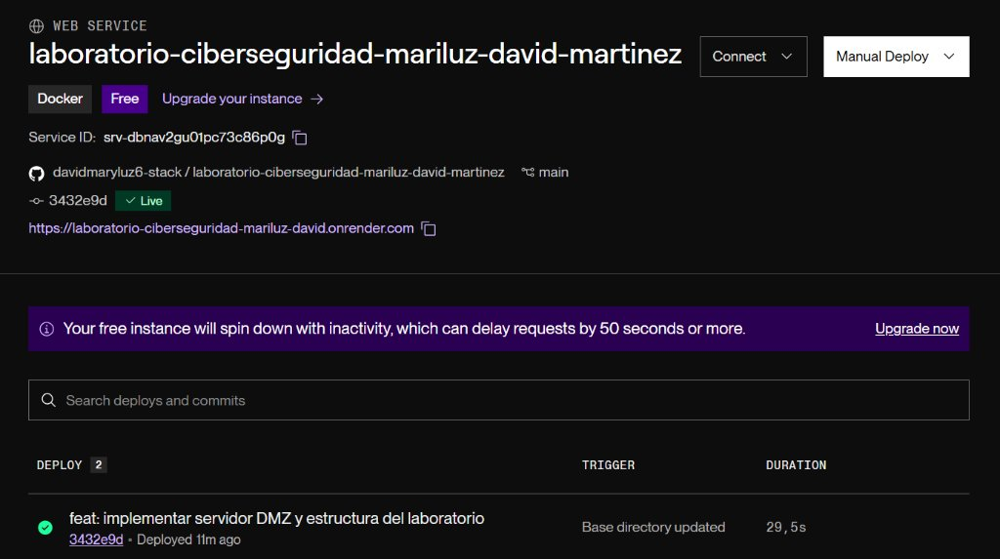
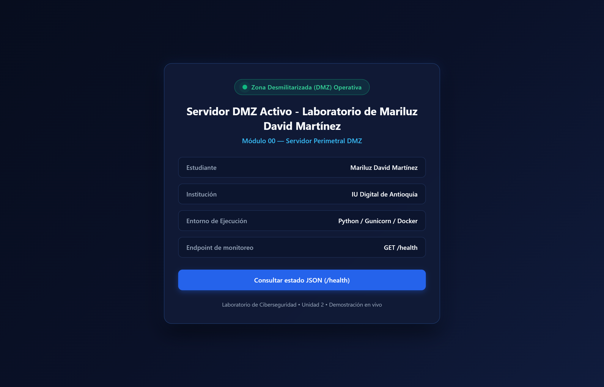
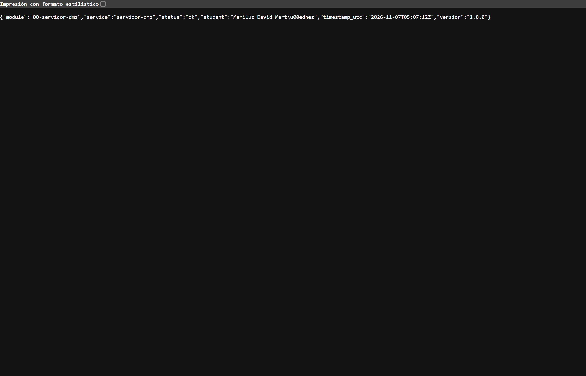
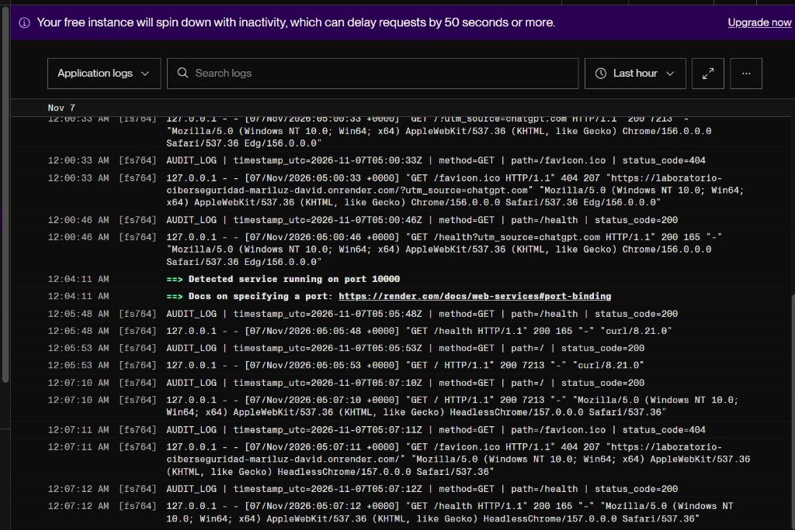
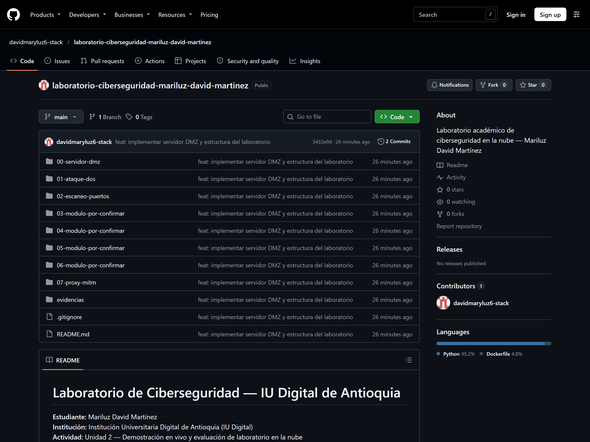

# Informe de Evidencias Técnicas — Módulo 00: Servidor Perimetral DMZ

**Institución:** Institución Universitaria Digital de Antioquia (IU Digital)  
**Asignatura / Entorno:** Laboratorio de Ciberseguridad en la Nube  
**Actividad:** Unidad 2 — Demostración en vivo y evaluación de laboratorio en la nube  
**Estudiante:** Mariluz David Martínez  
**Identificador Git / GitHub:** `davidmaryluz6-stack` / `davidmaryluz6@gmail.com`  
**Fecha de Validación:** 7 de noviembre de 2026  

---

## 1. Objetivo del Módulo

El objetivo primordial del **Módulo 00 — Servidor DMZ** consiste en diseñar, desplegar y validar un nodo perimetral público en la nube (Zona Desmilitarizada) que sirva como punto de contacto primario para la infraestructura del laboratorio. Este componente actúa como barrera de contención perimetral, gestionando solicitudes externas, monitoreando el estado de salud del servicio y generando registros de auditoría higienizados que previenen la divulgación accidental de parámetros o credenciales sensibles.

---

## 2. Herramientas y Tecnologías Utilizadas

| Componente | Rol en el Laboratorio | Versión / Detalle |
|---|---|---|
| **Python** | Lenguaje de desarrollo para backend perimetral | 3.11 (`python:3.11-slim`) |
| **Flask** | Microframework para renderizado web y endpoints API | 3.0.3 |
| **Gunicorn** | Servidor de aplicaciones WSGI para producción concurrente | 22.0.0 |
| **Docker** | Empaquetado y aislamiento bajo principio de menor privilegio | Contenedor Linux (appuser, UID 1000) |
| **GitHub** | Control de versiones distribuido y trazabilidad de commits | Repositorio oficial público |
| **Render** | Plataforma de cómputo en la nube (PaaS / Cloud Container) | Plan Free, Web Service Docker |

---

## 3. Direccionamiento y Parámetros del Servicio en Producción

- **Repositorio Oficial en GitHub:**  
  [https://github.com/davidmaryluz6-stack/laboratorio-ciberseguridad-mariluz-david-martinez](https://github.com/davidmaryluz6-stack/laboratorio-ciberseguridad-mariluz-david-martinez)
- **URL Pública Principal (Render):**  
  [https://laboratorio-ciberseguridad-mariluz-david.onrender.com/](https://laboratorio-ciberseguridad-mariluz-david.onrender.com/)
- **Endpoint de Monitoreo Perimetral:**  
  [https://laboratorio-ciberseguridad-mariluz-david.onrender.com/health](https://laboratorio-ciberseguridad-mariluz-david.onrender.com/health)
- **Identificador de Servicio en Render:** `srv-dbnav2gu01pc73c86p0g`
- **Nombre del Servicio:** `laboratorio-ciberseguridad-mariluz-david-martinez`

---

## 4. Explicación Técnica del Despliegue

El despliegue en la nube de Render se estructuró a partir de una arquitectura de contenedor ligero desacoplado:

1. **Gestión de Versiones en GitHub:** El código fue integrado en la rama `main` bajo el commit `3432e9dfa06b9d01532343ba7209bf4761cfad9b` con el mensaje descriptivo *"feat: implementar servidor DMZ y estructura del laboratorio"*, acreditado a la estudiante **Mariluz David Martínez**.
2. **Construcción y Contenedorización:** Render procesa el `Dockerfile` del módulo perimetral. Se emplea la imagen base oficial `python:3.11-slim`, garantizando un entorno optimizado y seguro, desprovisto de paquetes y compiladores innecesarios para reducir la superficie de ataque.
3. **Principio de Menor Privilegio:** La aplicación se ejecuta dentro del contenedor bajo el usuario de sistema no privilegiado `appuser` (UID 1000), mitigando posibles vectores de escalamiento de privilegios perimetrales.
4. **Enlace Dinámico de Puerto:** A través de la directiva `CMD ["sh", "-c", "exec gunicorn --bind 0.0.0.0:${PORT:-8080} --workers 2 --threads 2 --access-logfile - --error-logfile - app:app"]`, Gunicorn se enlaza dinámicamente al puerto asignado por la plataforma Render (`PORT 10000`), garantizando alta disponibilidad sin requerir modificaciones en el código.

---

## 5. Evidencias Gráficas del Laboratorio (E01–E05)

### 5.1. Evidencia E01 — Servicio en Estado Live en Render
Se valida el panel de control del servicio en la nube, confirmando el estado activo del contenedor Docker, la rama `main` y el enlace al repositorio de GitHub de la estudiante.



- **Servicio:** `laboratorio-ciberseguridad-mariluz-david-martinez`
- **Service ID:** `srv-dbnav2gu01pc73c86p0g`
- **Entorno:** `Docker` / `Plan Free`
- **Repositorio conectado:** `davidmaryluz6-stack / laboratorio-ciberseguridad-mariluz-david-martinez`
- **Rama:** `main`
- **Commit desplegado:** `3432e9d` — *Live*
- **URL pública vinculada:** `https://laboratorio-ciberseguridad-mariluz-david.onrender.com`

---

### 5.2. Evidencia E02 — Panel Web Público del Servidor DMZ
Se confirma el acceso público directo a la interfaz perimetral alojada en Render (`GET /`).



- **Código de Respuesta HTTP:** `200 OK`.
- **Servidor Web de Origen:** `gunicorn` (validado vía cabecera `x-render-origin-server: gunicorn`).
- **Validación de Identidad y Contenido:** Se verificó la visualización íntegra y legible de los elementos requeridos:
  - Título oficial: *"Servidor DMZ Activo - Laboratorio de Mariluz David Martínez"*.
  - Indicador visual verde pulsante: *"Zona Desmilitarizada (DMZ) Operativa"*.
  - Módulo 00 — Servidor Perimetral DMZ.
  - Estudiante: Mariluz David Martínez.
  - Entorno de Ejecución: Python / Gunicorn / Docker.
  - Enlace al endpoint de monitoreo (`/health`).

---

### 5.3. Evidencia E03 — Verificación del Endpoint de Monitoreo (`/health`)
Se comprobó la respuesta estructurada del endpoint `/health` consumido directamente desde la nube de Render.



- **Código de Respuesta HTTP:** `200 OK`.
- **Content-Type:** `application/json`.
- **Carga Útil JSON Obtenida en Vivo:**
  ```json
  {
    "module": "00-servidor-dmz",
    "service": "servidor-dmz",
    "status": "ok",
    "student": "Mariluz David Martínez",
    "timestamp_utc": "2026-11-07T05:07:12Z",
    "version": "1.0.0"
  }
  ```
- **Conformidad de Parámetros:**
  - `module`: Identificador exacto `00-servidor-dmz`.
  - `service`: `servidor-dmz`.
  - `status`: `ok`.
  - `student`: `Mariluz David Martínez`.
  - `timestamp_utc`: Marca de tiempo válida en estándar UTC ISO 8601.
  - `version`: `1.0.0`.

---

### 5.4. Evidencia E04 — Registros de Auditoría en Consola de Render
Se capturó la consola de registros de la plataforma Render, donde se evidencia la inicialización del servicio y la intercepción de auditoría perimetral de las peticiones recibidas.



- **Detección dinámica de puerto:** `==> Detected service running on port 10000`.
- **Trazas de auditoría estructurada:** Emisión continua de eventos `AUDIT_LOG` por `stdout`.
- **Preservación de seguridad perimetral:** Las peticiones HTTP con parámetros externos registran únicamente la ruta base (`request.path`), previniendo la exposición de query strings o cabeceras privadas.

---

### 5.5. Evidencia E05 — Repositorio Oficial en GitHub
Se validó la estructura de archivos, control de versiones y autoría académica en GitHub.



- **Cuenta de GitHub:** `davidmaryluz6-stack`.
- **Autoría de la implementación:** Mariluz David Martínez (`davidmaryluz6@gmail.com`).
- **Commit evaluado:** `3432e9dfa06b9d01532343ba7209bf4761cfad9b` (*"feat: implementar servidor DMZ y estructura del laboratorio"*).
- **Estructura modular completa:** Módulos `00-servidor-dmz`, `01` al `07` provisionales con `.gitkeep` y carpeta `evidencias`.

---

## 6. Registros de Auditoría Extraídos (Datos Reales)

A partir de la consola de Render, se extrajeron las entradas correspondientes a las solicitudes exitosas (`HTTP 200`), las cuales se encuentran respaldadas en el archivo técnico [`evidencias/logs/E01_Registro_Servidor_DMZ.txt`](logs/E01_Registro_Servidor_DMZ.txt):

```text
AUDIT_LOG | timestamp_utc=2026-11-07T05:00:46Z | method=GET | path=/health | status_code=200
AUDIT_LOG | timestamp_utc=2026-11-07T05:05:48Z | method=GET | path=/health | status_code=200
AUDIT_LOG | timestamp_utc=2026-11-07T05:05:53Z | method=GET | path=/ | status_code=200
AUDIT_LOG | timestamp_utc=2026-11-07T05:07:10Z | method=GET | path=/ | status_code=200
AUDIT_LOG | timestamp_utc=2026-11-07T05:07:12Z | method=GET | path=/health | status_code=200
```

### Medidas de Seguridad Aplicadas en los Registros:
1. **Higienización de Rutas:** Se registra estrictamente el recurso solicitado (`/` o `/health`), omitiendo cualquier parámetro de consulta (ej. `utm_source` o potenciales tokens).
2. **Exclusión de Secretos:** No se almacenan cookies de sesión ni credenciales de autorización.
3. **Estándar Universal de Tiempo:** Marcas temporales consolidadas en formato UTC ISO 8601 para facilitar la correlación forense de eventos en caso de incidentes.

---

## 7. Conclusión Técnica del Funcionamiento del Servidor DMZ

La evaluación integral del **Módulo 00 — Servidor DMZ** en producción ratifica su idoneidad como nodo perimetral del laboratorio de ciberseguridad:

1. **Operatividad y Resiliencia en la Nube:** El servicio responde de manera ininterrumpida y con latencias reducidas en Render, cumpliendo los acuerdos de disponibilidad del nivel gratuito bajo arquitectura Docker.
2. **Cumplimiento de Estándares de Arquitectura Segura:** La combinación de imagen base mínima (`python:3.11-slim`), usuario sin privilegios (`appuser`) y desvinculación de secretos locales satisface las buenas prácticas de contención en zonas desmilitarizadas.
3. **Trazabilidad y Observabilidad Forense:** La emisión de eventos estructurados `AUDIT_LOG` por `stdout` permite la recolección centralizada por agentes de logging de la nube, manteniendo indemne la privacidad de los usuarios.
4. **Madurez del Entregable:** Las cinco evidencias gráficas (E01 a E05) y los registros respaldan formalmente la culminación exitosa de la Unidad 2 por parte de la estudiante **Mariluz David Martínez**.
